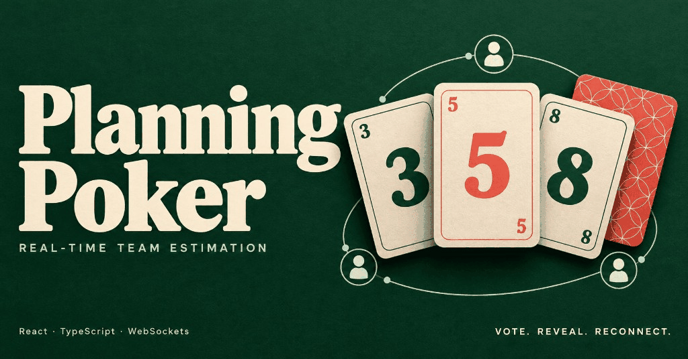

# Planning Poker

Vote in private. Reveal together. Reconnect with the round intact.

## Demo

The two-minute demo and the live room are linked here once the app is deployed. The opening beat is two browsers in one room: a vote on the left shows as voted on the right, and reveal shows both numbers. The same vote, placed while the left browser is offline, comes back with the message id it was sent with.

## The customer problem

A team estimates a story on a call. The first person to speak says a number, and everyone else adjusts before they answer. A shared deck stops that only if a refresh, a dropped connection, or a late vote cannot change what the room agreed.

Planning Poker is a portfolio prototype of that room:

Vote → Reveal → Reconnect

Players join from one link, pick a card the others cannot see, and reveal together. Anyone in the room can reveal. It does not require an account, keep a room after the server restarts, or replace the board the team already uses.

## What it does

- Opens a room from a link and shows who has joined, who has voted, and who is still connected
- Hides every vote until reveal, so the number is not in the snapshot a browser can read
- Shows your card the moment you pick it, and restores the server's card if that vote is rejected
- Holds a vote cast while offline and sends it again, with the same id, after the socket reconnects
- Keeps your seat across a refresh, shows a dropped connection after three seconds, and removes that player after thirty
- Treats the deck as a radio group, and moves focus to the results when the round is revealed

## Stack

| Layer | Choice | Why |
| --- | --- | --- |
| Language | TypeScript | One language for the UI, the server, and the messages between them |
| UI | React and Vite | Renders the deck, the participants, and the connection status |
| Client state | Zustand | Holds the room snapshot, the connection status, and at most one pending vote |
| Real time | WebSockets (`ws`) | Broadcasts a full room snapshot on every join, vote, reveal, and reconnect |
| Protocol | Zod | Defines each message once; both sides parse it, and the types come from the schema |
| Server | Node 22 | Keeps each room in memory and answers a vote with ack or rejected |
